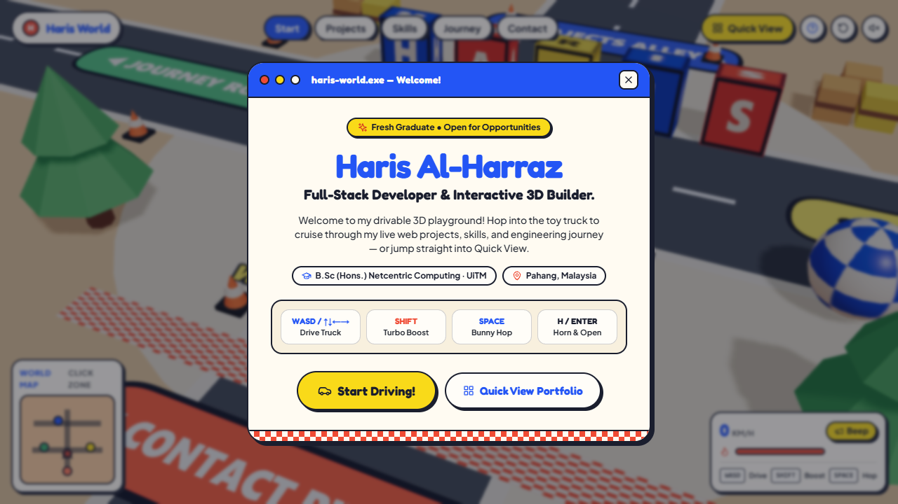
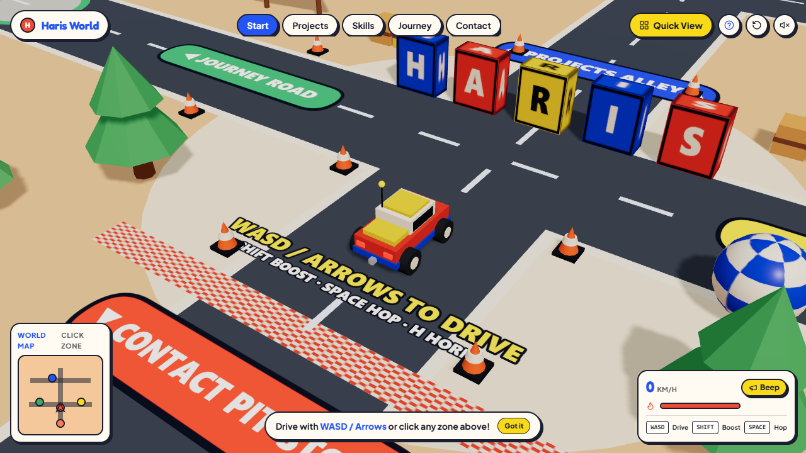
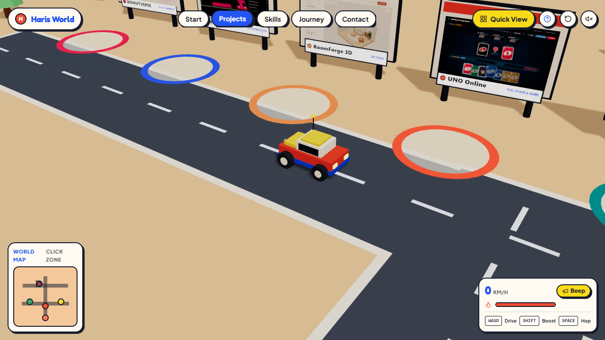
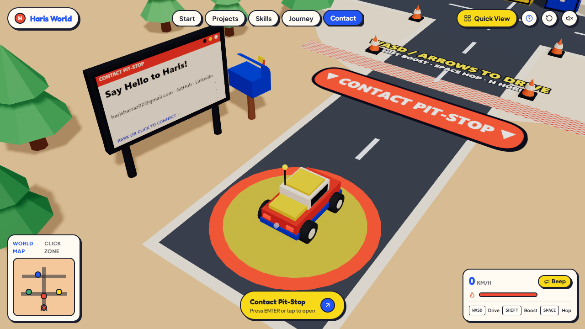

<div align="center">

# Haris 3D World

### *Drive through Haris Al-Harraz’s sunlit 3D playground to explore live projects, skills, and engineering milestones.*

[](https://haris-3d-world.pages.dev)
[](https://nextjs.org/)
[](https://docs.pmnd.rs/react-three-fiber)
[](https://www.typescriptlang.org/)
[](https://tailwindcss.com/)
[](https://www.framer.com/motion/)

<br />



</div>

---

## Highlights

- **Interactive 3D Driving World** — Hop into a procedural coral-and-yellow 3D toy truck with spinning/steering wheels, bouncy suspension pitch & roll, turbo boost flames, exhaust puffs, bunny hop (`Space`), stunt ramp launch, and smashable props (`HARIS` letter blocks, bowling pins, traffic cones, wooden crates, skill cubes, and a giant soccer ball).
- **5 Road-Connected Zones**
  - **Start Plaza** — Welcome intro popup (`haris-world.exe`), knockable 3D `HARIS` blocks, and painted ground controls.
  - **Projects Drive-In Boulevard** — 11 camera-facing 3D billboards displaying real screenshots of verified live web projects (`VELA — Donut V`, `Cosmic Odyssey`, `Brawl Arena`, `DONUTVERSE`, `KeyThock 3D`, `RoomForge 3D`, `UNO Online`, `Windows 98 Web OS`, `Papercraft PDF`, `Ember & Olive`, `HIV Atlas`) with glowing drive-in parking pads.
  - **Skills Playground** — 4 themed skill islands paired with a chevron stunt ramp and 10-pin bowling lane.
  - **Journey Road** — Roadside milestone boards highlighting experience at Alev Global Sdn. Bhd., UiTM Kampus Jasin, STPM, and RawSEC CTF.
  - **Contact Pit-Stop** — Roadside billboard, animated toy mailbox, and one-click Email, GitHub, LinkedIn, and Phone card.
- **Playful Retro-Pop HUD & Recruiter Quick View** — Zone teleport pills, live clickable minimap radar, speedometer + turbo meter, mobile touch joystick & pedals, retro OS-window project modals, and a full **Quick View** drawer so visitors can browse all 17 projects without driving.
- **Zero-WASM 60fps Arcade Physics + Web Audio SFX** — Pure TypeScript vehicle & prop impulse physics (`src/lib/vehiclePhysics.ts`, covered by Node unit tests) plus synthesized Web Audio engine hum, two-tone horn, hop chirp, pad chimes, and prop bonks.

---

## Visual Preview

| Start Plaza | Projects Drive-In Boulevard |
| --- | --- |
|  |  |

| Contact Pit-Stop |
| --- |
|  |

---

## Controls

| Input | Action |
| --- | --- |
| `W A S D` / `Arrow Keys` | Drive & steer |
| `Shift` | Turbo boost |
| `Space` | Bunny hop |
| `H` | Honk toy horn |
| `Enter` | Open active parking pad modal |
| `R` | Reset car & smashable props |
| `Esc` | Close open modal / drawer |
| **Mobile Touch** | Left virtual joystick + Hop, Horn & Turbo buttons |

---

## Quick Start

```bash
# 1. Clone the repository
git clone https://github.com/risterz/haris-3d-world.git
cd haris-3d-world

# 2. Install dependencies
npm install

# 3. Start local dev server
npm run dev
```

### Verification Commands

```bash
# Run arcade vehicle & prop physics unit tests
node --test tests/vehiclePhysics.test.mjs

# Type-check & production build
npm run type-check
npm run build
```

---

## Project Structure

```text
haris-3d-world/
├── docs/screenshots/          # Verified desktop screenshots
├── public/images/projects/    # Live project screenshots for 3D billboards & modals
├── src/
│   ├── app/                   # Next.js App Router layout, styles, icon & page entry
│   ├── components/
│   │   ├── world/             # WorldCanvas, Vehicle, TerrainAndRoads, InteractiveProps & 4 zones
│   │   └── hud/               # WelcomeModal, TopNavBar, Minimap, Speedometer, MobileControls & modals
│   ├── data/                  # worldLayout, projects, skills, timeline & personal info
│   ├── lib/                   # vehiclePhysics, soundEngine & canvasTextures
│   └── types/                 # Shared 3D world & telemetry interfaces
└── tests/
    └── vehiclePhysics.test.mjs
```
